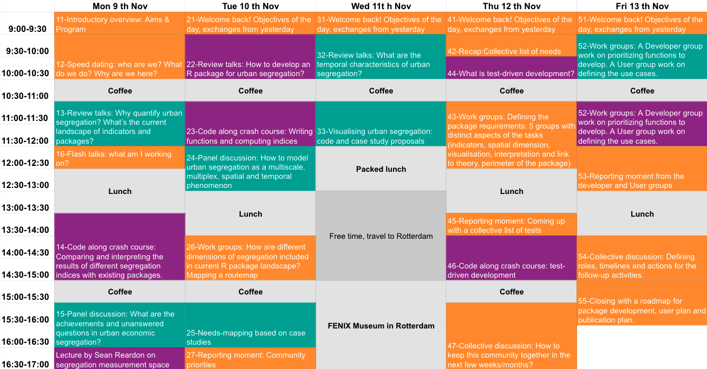

# Welcome {background-gradient="linear-gradient(135deg, white 30%, #00A99D)"}

## Aims of the workshop

- foster **research conversations** on the state of segregation measurement and its relation to theories, data, scale and social attributes considered.
- create a **community** of urban scholars to collaborate on comparative research, theory and methodology development .
- prepare the development of a **new R package** to assist with segregation measure selection, computation, visualization and/or analysis.


## Some background

> Urban segregation – the pattern of (geographical) separation between people of different social groups or economic levels in cities.

- large component of the scientific program of urban sciences (geography, sociology, demography and economics). 
- dire consequences for social cohesion, economic mobility, health and education opportunities, especially in a context of rising economic inequalities and uneven development. 

## Some questions

- How does urban segregation relate to economic inequality? 
- At which scale can urban planners best design more efficient policies to reduce urban segregation? 
- What are the mechanisms through which some places produce better outcomes than others? 
- Does segregation directly harm children in vulnerable families?

## Your questions {.scrollable}

- [How does adding new dwellings to existing housing stock change local segregation values at different scales?]{style="color:#00A99D;"}
- [To which extent the links formed by agents across neighborhoors mirror/solidify/diverge from segregation patterns?]{style="color:#00A99D;"}
- [How much segregation might standard measures miss in a city of walled communities, and can urban form help reveal it?]{style="color:#00A99D;"}
- [How do patterns of urban infrastructural accessibility or inequality shape the everyday experiences of disabled residents in African cities?]{style="color:#00A99D;"}
- [How can we compare daily variations in urban segregation across different cities when: (i) the population distributions with respect to socio-demographic categories differ between cities; (ii) cities have different geographical perimeters; and (iii) the primary spatial units (neighbourhoods) differ ?]{style="color:#00A99D;"}

## Indices of segregation

- Historical (racial) segregation indices, reviewed by [@massey1988dimensions] 
- Spatial segregation [@white1983measurement] [@morrill1991]
- Multi-groups [@wong1998measuring]
- Ordinal variables [@reardon2009measures]

## Indices of segregation

```{r}
library(tidyverse)
# library(devtools)
# install_github("deleetdk/kirkegaard")
library(kirkegaard)

index <- read_csv("assets/index_inventory-aiex.csv") |>
  pivot_longer(cols = c("OasisR","divseg","segregation",
                        "seg","mutualinf","ineq"),
               names_to = "Package name",
               values_to = "includes",
               values_drop_na = F) |>
  mutate(includes = as.factor(includes),
         `Index name` = fct_reorder(`Index name`, desc(`Index name`))) 


  ggplot(index, aes(y=`Index name`, x=`Package name`, fill=includes)) + 
  geom_raster() +
    scale_fill_manual(values = c("1" = "#93278F"), na.value = "white") +
    guides(fill="none") +
    theme_minimal() +
    theme(axis.text.x = element_text(angle = 50, 
                                    vjust = 0.95, hjust=1)) 
  
```


## Data on people in cities

- register-based microdata (NL, AT, SE, NO)
- granular census tract-based data on an annual basis (ES, FR). 
- less granular/less frequent census and survey data
- nightlight data as a proxy of population density and income (CN)
- first hand interview and survey data 

## Methodological infrastructure

- Websites, applications & software for computing segregation
- open-source packages in Python (`segregation`) 
- open-source packages in R (`OasisR`, `seg`, `segregation`, `divseg`, `ineq`, `mutualinf`)

But, we are missing a few things...

## 1. A “routemap” to choose urban segregation measures.


## 2. A way to make innovative methods accessible to answer big theoretical questions of the field

- Making the computation of relevant indices accessible and painless 
- Facilitating the design of spatial counterfactuals and robustness analysis
- Reorienting the development of indices towards unanswered questions of the field

## 3. A forum where sharp theoretical developments meet novel computational science

Different journals, conferences, networks and departments.

> Current theoretical developments in the field of urban segregation often ignore methodological innovations while methodological developments do not address current debates of the field.

## 4. A new and updated toolbox of segregation indices, which

- allows for **combinations** of data features (multi-group AND spatial, ordinal AND spatial)
- is **up to date** with the methodological literature (e.g. Divergence index)
- considers **multilayered attributes of segregation**, as exposed by network segregation [@kazmina2024socio], daytime segregation [@le2017social] and multiscale segregation [@petrovic2018multiscale].


## How to?

- **Diversity** of participants (profiles, location, skills and interests)
- Needs-mapping **activities**
- 5 days to prepare for **longer term** development
- Italian catering!
- open source / collaborative / test-driven package development


## Program




## Organising team outside TU Delft {.smaller}

- [Julie Vallée](https://lisst.univ-tlse2.fr/home/julie-vallee), Senior researcher at CNRS, LISST, France

- [Julien Migozzi](https://jmigozzi.github.io/), Assistant Professor in Development Studies at University of Cambridge, UK

- [Levi John Wolf](https://www.ljwolf.org/), Associate Professor of Spatial Analysis at the University of Bristol , UK

- [Selcan Mutgan](https://www.selcanmutgan.com/), Assistant Professor at the Institute for Analytical Sociology in Linköping University, Sweden

- [Seong-Yun Hong](https://khu.elsevierpure.com/en/persons/seong-yun-hong/), Associate Professor at Kyung Hee University, South Korea

- [Yuliia Kazmina](https://www.uva.nl/en/profile/k/a/y.kazmina/y.kazmina.html), PhD candidate at the Faculty of Social and Behavioural Sciences, University of Amsterdam (NL)

## Organising team @ TU Delft {.smaller}

- [Ana Petrovic](https://research.tudelft.nl/en/persons/a-petrovi%C4%87/), Assistant Professor in urban studies at [{fig-align="left" width="60"}](https://www.tudelft.nl/) [{fig-align="left" width="30"}](http://rbanism.org/)

- [Claudiu Forgaci](https://cforgaci.github.io/), Assistant Professor in urban design at [{fig-align="left" width="60"}](https://www.tudelft.nl/) [{fig-align="left" width="30"}](http://rbanism.org/)

- [Clémentine Cottineau-Mugadza](https://clementinecttn.github.io/), Assistant Professor in urban studies at [{fig-align="left" width="60"}](https://www.tudelft.nl/) [{fig-align="left" width="30"}](http://rbanism.org/)[{fig-align="left" width="30"}](http://erc-segue.nl/)

- [Daniele Cannatella](https://www.tudelft.nl/staff/d.cannatella/), Assistant Professor in spatial data science at [{fig-align="left" width="60"}](https://www.tudelft.nl/) [{fig-align="left" width="30"}](http://rbanism.org/)

- [Ignacio Urria Yáñez](https://www.tudelft.nl/staff/i.a.urriayanez/), PhD Candidate in urban studies at [{fig-align="left" width="60"}](https://www.tudelft.nl/) [{fig-align="left" width="30"}](http://rbanism.org/)

- [Javier San Millan Tejedor](https://javiersanmillan.github.io/), PhD Candidate in urban studies at [{fig-align="left" width="60"}](https://www.tudelft.nl/) [{fig-align="left" width="30"}](http://rbanism.org/)[{fig-align="left" width="30"}](http://erc-segue.nl/)


## What is SEGUE?     

It is an project dedicated to the estimation, modelling and identification of policy scenarios to reduce urban economic segregation in the Netherlands.

It is funded by the European Research Council between 2022 and 2029. 

SEGUE funds the organisation of this meeting.

[erc-segue.nl](erc-segue.nl)

 [{fig-align="left" width="100"}](http://erc-segue.nl/) 

## Initial results from SEGUE {.scrollable .smaller}

1. urban economic **segregation** is linked to economic **inequality** through a variety of causal pathways, including but not restricted to housing markets [@cottineau2025economic] [@paulinaslr]
2. income **segregation in the Netherlands** is rather low, stable and heterogeneous in Dutch metropolitan areas, but wealth inequalities and segregation are much larger and growing since 2011 [@san_millan_economic_2025] [@sanmillan2025wealth]
3. the size, spatial dispersion and allocation rules of **social housing** play an important role in dampening the effect of economic inequality on economic segregation, but that they vary significantly between cities
[@san2026inequality] [@buitrago2026]. This directly affects the type of **policies** to design in order to reduce income and wealth segregation.

## What is Rbanism? 

::::: {layout-ncol="2"}
::: {}
A community of practice from TU Delft, whose mission is to build capacity, competence, and confidence for working with data and research software in the urbanism community.

[{fig-align="centre" width="150"}](http://rbanism.org/) 

:::

::: {}

We organise trainings, challenges, workshops and community events. Our skills and experience in the fields of **open science** and **community building** will serve this workshop.

{fig-align="centre" width="150"}
:::
::::: 


## Rbanism's latest productions

💡 **Training**: [Geospatial Data Carpentry for Urbanism](https://datacarpentry.github.io/r-intro-geospatial/) workshop. 

📦 **Software**: R packages [rcrisp](https://github.com/CityRiverSpaces/rcrisp), [rcoins](https://github.com/CityRiverSpaces/rcoins), and [visor](https://github.com/CityRiverSpaces/visor).   

🗺️ **Challenges**: [#30DayMapChallenge2026](https://github.com/Rbanism/30DayMapChallenge2026), [#30DayMapChallenge2025](https://github.com/Rbanism/30DayMapChallenge2025) and [#30DayMapChallenge2024](https://github.com/Rbanism/30DayMapChallenge2024).

📝 **Publications**: [Guidelines and open-source toolbox for systematic literature reviews in the field of urbanism](https://osf.io/preprints/socarxiv/w5b8v).


## This is an open source project

Preparation materials and upcoming contribution to use two licenses:

- Apache License 2.0. for Code (R source, tests, and other software) 
- Creative Commons Attribution 4.0 International (CC BY 4.0) for workshop materials and outputs (data, presentations, notebooks, prose, figures, and other non-code content) 

## Infrastructure for collaboration


::::: {layout-ncol="2"}
::: {}
- Workshop material: [github.com/SEGUE-Project/2026Workshop](https://github.com/SEGUE-Project/2026Workshop)
- Livecode: [github.com/SEGUE-Project/workshop-livecode](https://github.com/SEGUE-Project/workshop-livecode)
- test-driven development: [erc-segue.nl/tdd-r-pkg/](https://erc-segue.nl/tdd-r-pkg/)

:::
These slides


::: {}
:::::


## References {.scrollable .smaller}

::: {#refs}
:::

# Getting to know each other {background-gradient="linear-gradient(135deg, white 30%, #93278F)"}

## Form 9 groups of 3 & ask each other:

- Who are you?
- What do you do?
- Why are you here?

```{r}
#| echo: false
#| cache: false
countdown::countdown(minutes = 9)
```

## Change groups!

- Who are you?
- What do you do?
- Why are you here?

```{r}
#| echo: false
#| cache: false
countdown::countdown(minutes = 9)
```

## Okay! Now you know 6 people! {.scrollable}

```{r}
#| label: maps
#| echo: false

library(tidyverse)
library(sf)
library(mapsf)
library(rnaturalearth)
sf_use_s2(FALSE)

country <- read_csv("assets/country.csv") |>
  mutate(iso = ISO3_Country) |>
  group_by(iso) |>
  summarise(n = n())

world <- st_as_sf(ne_countries()) |>
  mutate(iso = adm0_a3) |>
  left_join(country, by = "iso") |>
  mutate(n = if_else(!is.na(n), n, 0),
         status = if_else(n>0, "≥ 1 participant", "No participant")
         ) |>
  st_transform("ESRI:54024")

mf_map(
  x = world,
  var = "status",
  type = "typo",
  leg_pos = "topleft",
  leg_title = "Country representation",
  pal = c("#00A99D", "#7C7C7C"),
  val_order = c("≥ 1 participant", "No participant"),
  lwd = .2, leg_title_cex = 1,
  leg_val_cex = .8, leg_no_data = "No data",
  leg_box_cex = c(.5, 2), leg_box_border = NA,
  border = "white"
  )

```

## The 27 {.scrollable .smaller}

- [**Adrian Nowacki**]{style="color:#f57b26;"}, PhD Student, Doctoral School of Natural Sciences, Adam Mickiewicz University in Poznań, Poland.
- [**Alok Kumar**]{style="color:#00A99D;"}, PhD Candidate, Jawaharlal Nehru University New Delhi, India
- [**Ana Luisa Maffini**]{style="color:#00A99D;"}, Researcher/Postdoctoral Researcher at Urban and Regional Planning program at UFRGS, Brasil
- [**Ana Petrović**]{style="color:#f57b26;"}, Assistant Professor in urban studies at TU Delft, NL
- [**Benjamin Jarvis**]{style="color:#93278F;"}, Associate Professor, Institute for Analytical Sociology, Linköping University, Sweden
- [**Benjamin Rosche**]{style="color:#93278F;"}, Assistant Professor of Computational Social Science, New York University Abu Dhabi, Abu Dhabi
- [**Claudiu Forgaci**]{style="color:#93278F;"}, Assistant Professor in urban design and analytics at TU Delft, NL
- [**Clémentine Cottineau-Mugadza**]{style="color:#f57b26;"}, Assistant Professor in urban studies at TU Delft, NL
- [**Daniele Cannatella**]{style="color:#93278F;"}, Assistant Professor in spatial data science at Delft, NL
- [**Giuliana La Mantia**]{style="color:#f57b26;"}, Post-doc researcher at University of Genoa, Italy.
- [**Guilherme Kenjy Chihaya Da Silva**]{style="color:#f57b26;"}, Associate Professor, Nord University, Faculty of Social Sciences, Norway
- [**Ignacio Urria Yáñez**]{style="color:#93278F;"}, PhD Candidate in urban studies at Delft, NL
- [**Javier San Millán Tejedor**]{style="color:#f57b26;"}, PhD Candidate in urban studies at Delft, NL
- [**Jiannis Kaućič**]{style="color:#00A99D;"}, Scientific Staff (Praedoc) at the Institute for Urban and Regional Research (ÖAW), Austria
- [**Julie Vallée**]{style="color:#00A99D;"}, Senior researcher at CNRS, LISST, France
- [**Julien Migozzi**]{style="color:#00A99D;"}, Assistant Professor in Development Studies at University of Cambridge, UK
- [**Juta Kawalerowicz**]{style="color:#00A99D;"}, Lecturer at Stokholm University, Sweden
- [**Karina Trelles**]{style="color:#00A99D;"}, Master student at University of Brescia, Italy
- [**Levi John Wolf**]{style="color:#93278F;"}, Associate Professor of Spatial Analysis at the University of Bristol, UK
- [**Nadeem Ullah**]{style="color:#00A99D;"}, Postdoctoral Researcher, School of Architecture, Tianjin University, China
- [**Onur Tumturk**]{style="color:#00A99D;"}, Marie Curie Postdoc, Bilkent University, Turkey
- [**Onyinyechi Ossai**]{style="color:#00A99D;"}, Senior Lecturer/University of Nigeria, Nsukka, Nigeria
- [**Priyanka deSouza**]{style="color:#00A99D;"}, Assistant Professor, University of Colorado Denver, USA
- [**Selcan Mutgan**]{style="color:#f57b26;"}, Assistant Professor at the Institute for Analytical Sociology in Linköping University, Sweden
- [**Seong-Yun Hong**]{style="color:#93278F;"}, Associate Professor at Kyung Hee University, South Korea
- [**Timothée Giraud**]{style="color:#93278F;"}, Research engineer at CNRS, UAR RIATE - Center for spatial analysis and geovizualisation, France
- [**Yuliia Kazmina**]{style="color:#f57b26;"}, PhD candidate at the Faculty of Social and Behavioural Sciences, University of Amsterdam, NL

## Developer profile {background-gradient="linear-gradient(135deg, white 30%, #93278F)"}

...because you are experienced in programming and/or have built R packages before

## User profile {background-gradient="linear-gradient(135deg, white 30%, #00A99D)"}

...because you are experienced in segregation analysis, interpretation and/or have a strong case study to test the package

## Interface profile {background-gradient="linear-gradient(135deg, white 30%, #f57b26)"}

...because you are experienced in translating between developer and user profiles

## Next: Coffee. Then Review talks: "Why quantify urban segregation? What’s the current landscape of indicators and packages?"