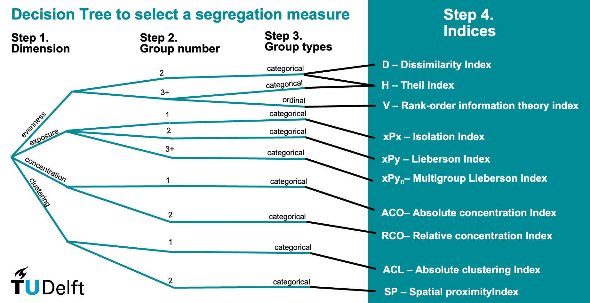

## Aims of the workshop

- foster **research conversations** on the state of segregation measurement and its relation to theories, data, scale and social attributes considered.
- create a **community** of urban scholars to collaborate on comparative research, theory and methodology development.
- prepare the development of a **new R package** to assist with segregation measure selection, computation, visualization and/or analysis.

## Aims of the workshop

- foster **research conversations** on the state of segregation measurement and its relation to theories, data, scale and social attributes considered. ✅
- create a **community** of urban scholars to collaborate on comparative research, theory and methodology development.
- prepare the development of a **new R package** to assist with segregation measure selection, computation, visualization and/or analysis.

## Aims of the workshop

- foster **research conversations** on the state of segregation measurement and its relation to theories, data, scale and social attributes considered. ✅
- create a **community** of urban scholars to collaborate on comparative research, theory and methodology development. ▶️ how to keep it going?
- prepare the development of a **new R package** to assist with segregation measure selection, computation, visualization and/or analysis.

## Aims of the workshop

- foster **research conversations** on the state of segregation measurement and its relation to theories, data, scale and social attributes considered. ✅
- create a **community** of urban scholars to collaborate on comparative research, theory and methodology development. ▶️ how to keep it going?
- prepare the development of a **new R package** to assist with segregation measure selection, computation, visualization and/or analysis. ▶️ how to finish?

## How to?

::::: {layout-ncol="2"}
::: {}
Open this document:

🔗 [Task distribution](https://docs.proton.me/sheet?mode=open-url&token=E6CC98TXZ0&linkId=o5154sezO_l2gL09MtPT-g#0HmLdqa2iazq)
:::

::: {}
- Identify task being discussed
- Fill in your name in lead/contributor column where you can contribute
- Suggest additional / reduced / split tasks at the end
- Suggest updated need / input / output / deadline
:::
:::::

# Package development {background-gradient="linear-gradient(135deg, white 30%, #93278F)"}

## Dimensions of package development

1.  Matching **needs** with technical **fixes**: which indicators? which spatial environments? which robustness checks?
2.  Matching **techniques** with interpretation and **theoretical questions**: case studies & documentation
3.  **Process**: sequence and milestones of package development

## 1.1. Needs\>fixes: Which indicators?

1.  divergence index (1.1.1)
2.  neighborhood Sorting Index (1.1.2)
3.  centile Gap Index (1.1.3)
4.  whatever is in Python `segregation`

## 1.2. Needs\>fixes: Which environments?

1.  spatial multiscale (1.2.1)
2.  temporal (1.2.2)
3.  accessibility-based (1.2.3)
4.  ?

## 1.3. Needs\>fixes: Which robustness checks?

1.  standard error and confidence intervals estimation via bootstrapping (1.3.1)

2.  correction for small sample bias (1.3.2)

3.  standard comparison with comparable indicators (1.3.3)?

4.  

## 1.3. Needs\>fixes: The “routemap” .

## 2.1 theory\>technique: Temporal segregation

1.  Activity spaces and daytime segregation (2.1.1)

2.  Lifecourse and long term segregation (2.1.2)

3.  Neighbourhood change and population segregation (2.1.3)

4.  

## 2.2 theory\>technique: Compositional effects

1.  Compositional effects (2.2.1)

2.  

## 2.3 theory\>technique: Documentation

1.  Testing indicators on case study (2.3.1)

2.  Documenting (geo)data (2.3.2)

3.  Interpretations and generalisation (2.3.3)

4.  

## 3.1. Development process: Tests

1.  Technical tests (3.1.1)

2.  Case study tests (3.1.2)

3.  

## 3.2. Development process: Development

1.  Development (3.2.1)

2.  Code review (3.2.2)

3.  

## 3.3. Development process: Evaluation

1.  Evaluation on case study (3.3.1)

2.  Comparative evaluation (3.3.2)

3.  

## 3.4. Development process: production

1.  Documentation (3.4.1)

2.  Packaging (3.4.2)

3.  Publication on CRAN (3.4.3)

4.  Publication of academic articles for JOSS/EPB/Urban Studies? (3.4.4)

# Community {background-gradient="linear-gradient(135deg, white 30%, #f57b26)"}

## What type of group do we want to be?

::::: {layout-ncol="2"}
::: {}
- Co-authors (formal, short-term, project-based)
- Collective (informal, mid-term, semi-open)
- Community (longer term, growing)
:::

::: {}
- **Horizontal** distribution of roles and responsibilities
- **Hierarchical** organisation with core active group and contributors?
- Something **in between**?
:::
:::::

## Who do we reach out to? (user group)

- students & staff of our institutions
- R-user groups: Rbanism / ElementR / rOpenSci, R Ladies

## Who do we ask for help? (diffusion)

- Spatial Data Science across Laguage to translate Python to R
- Sean Reardon?

# Actions {background-gradient="linear-gradient(135deg, white 30%, #00A99D)"}

## Immediate tasks

::::: {layout-ncol="2"}
::: {}

🔗 [Task distribution](https://docs.proton.me/sheet?mode=open-url&token=E6CC98TXZ0&linkId=o5154sezO_l2gL09MtPT-g#0HmLdqa2iazq)
:::

::: {}
- Completing the plan by 13 Dec. 2026
- Executing the plan within 6 months?
:::
:::::

## Longer term

- online meetings
- publication writing/review
- conference
