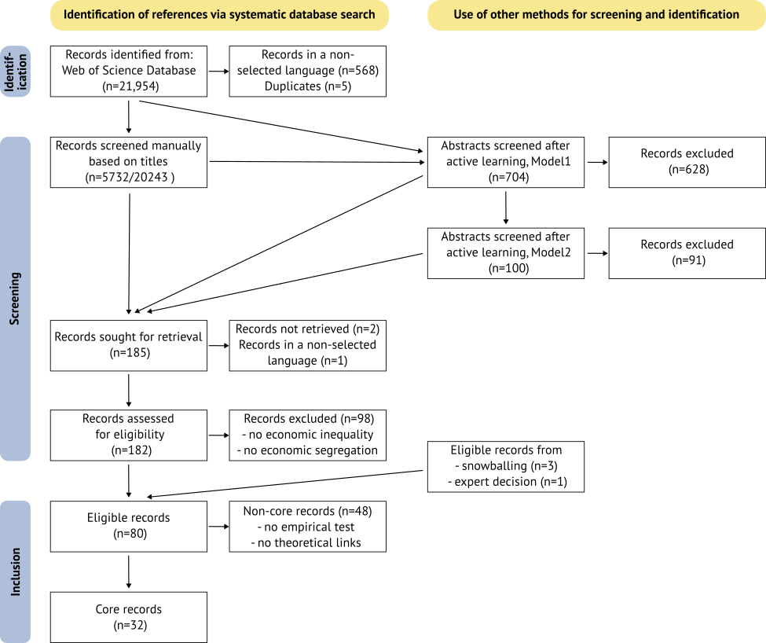
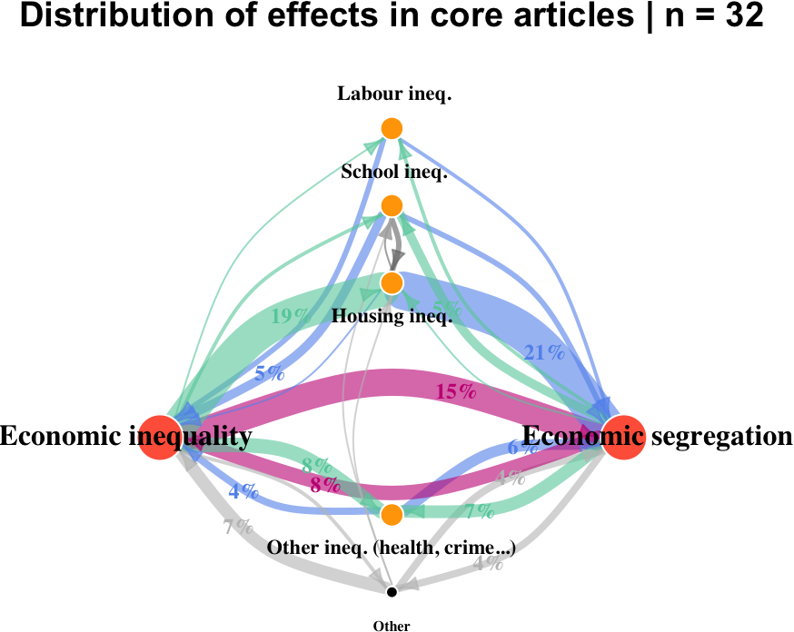
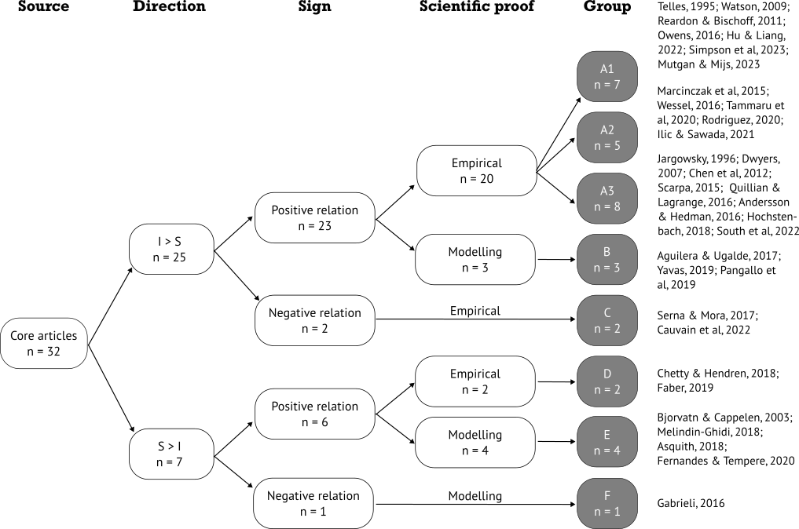
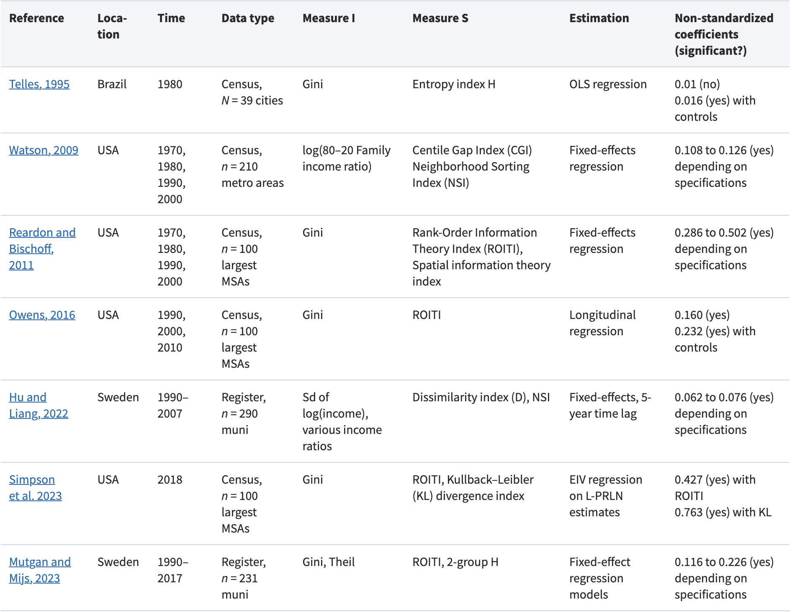

## Diversity of approaches to modelling within SEGUE

- Theoretical modelling: causal pathways and multidisciplinary approaches
- Empirical modelling: factors associated with income/wealth segregation variation
- Agent-based modelling: mechanism-based explanation of segregation persistence

# Theoretical modelling {background-gradient="linear-gradient(135deg, white 30%, #00A99D)"}

## Systematic literature review

- “cycle of segregation” approach: economic inequality means unequal housing resources, which shape residential environments, social networks and bundle of opportunities [@krysan2017cycle] [@galster2017spatial]
- “vicious circles of segregation” approach [@tammaru2021spatial]: “Segregation experienced in one life domain tends to be reproduced in other life domains […] Segregation experienced early in life is often reproduced later in life and transmitted from parents to children because of the interconnected lives of the family members."

## Systematic literature review {.smaller}


```{r}
#| echo: true
#| message: false
#| warning: false
#| eval: false


((TS = segregation AND (TS = income OR TS = wealth OR TS = economic))
OR (TS = inequality AND (TS = income OR TS = wealth OR TS = economic)))
AND (ALL = mechanis* OR ALL = expla?n* OR ALL = effect* OR ALL = caus* OR ALL = relation* OR ALL = process*)
AND (AB = segregation OR AB = inequality)
NOT (AB = spatial inequality)
```

::::: {layout-ncol="2"}
::: {}

{width=70%} 

:::

::: {}

- Does economic segregation vary with economic inequality, and to what extent are the two phenomena linked?

- Which causal pathways and mechanisms are proposed to explain their connection?

- To what extent does existing research belong to distinct literatures? 

- What are the consequences regarding the comparability of results and the compatibility of mechanisms?

[@cottineau2025economic]  
:::
:::::

## Results {.scrollable}


{width=100%} 


## 

{width=120%}

## 

{width=100%}

# Empirical modelling {background-gradient="linear-gradient(135deg, white 30%, #93278F)"}

## Regression of income and wealth segregation with:

- economic inequality 
- city size 
- housing tenure distribution
- social housing concentration 
- social housing allocation rules

Source: [@san_millan_economic_2025] [@sanmillan2025wealth] [@san2026inequality] [@buitrago2026] 

## Effect of public subsidy on:

- housing unit selection
- residential neighbourhood 

> Housing vouchers are not necessarily used to reduce economic segregation. Household operate trade-offs between units quality, place attachment and bundle of opportunity

[@deluca2020not]


# Agent-based modelling {background-gradient="linear-gradient(135deg, white 30%, #f57b26)"}

## Mechanisms behind segregation emergence

-	Homophily & clustering (Schelling)
- Real estate markets in unequal societies
-	Urban morphology & segregative potential

[@paulinaslr]


## Additional considerations in SEGUE

- **Lifecourse of residential needs**: household transitions produce changes in residential needs, both in terms of housing unit and residential environments. - **Contextual effects**: individuals’ bundle of opportunities depend on where they spend time and who they are exposed to.
-	**Wealth accumulation through residential real estate**: contemporary houses in capitalist states function as shelters and assets. 
- **Social housing** and the geography of supply price distortion


## Thank you {.scrollable .smaller}

::: {#refs}
:::
