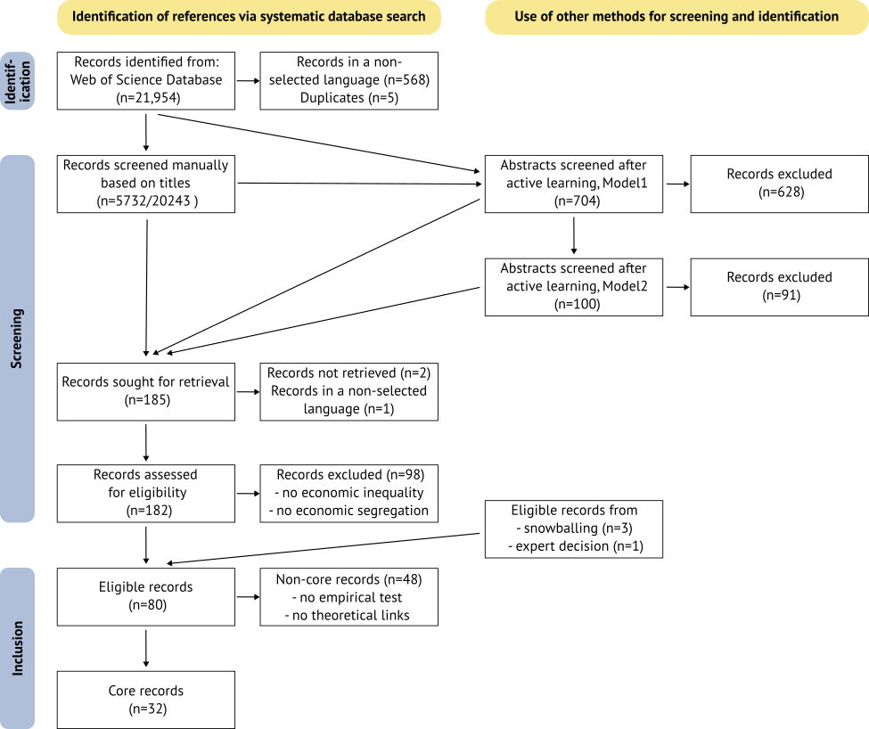
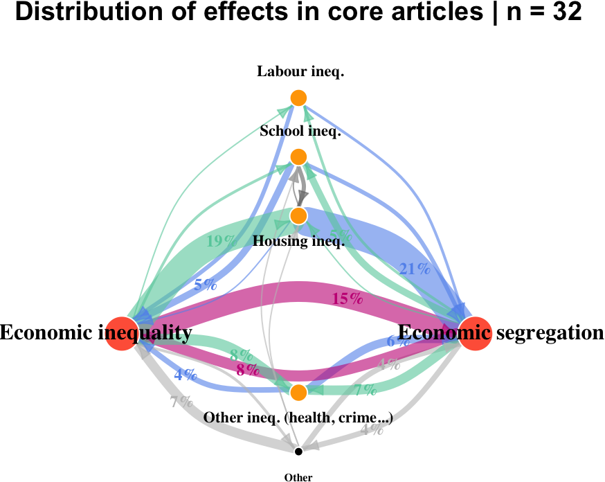
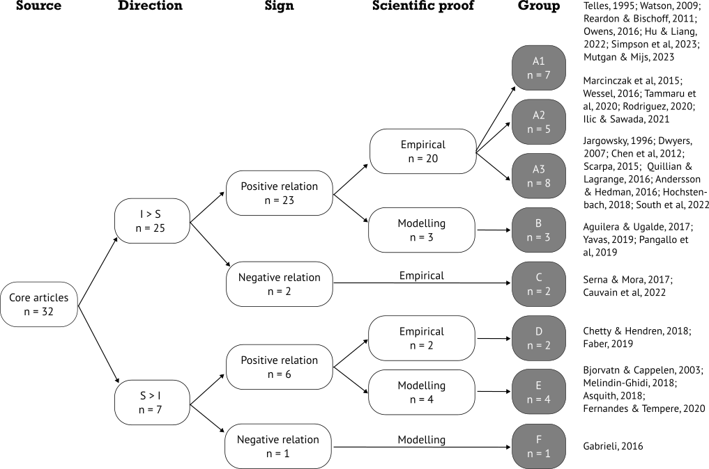
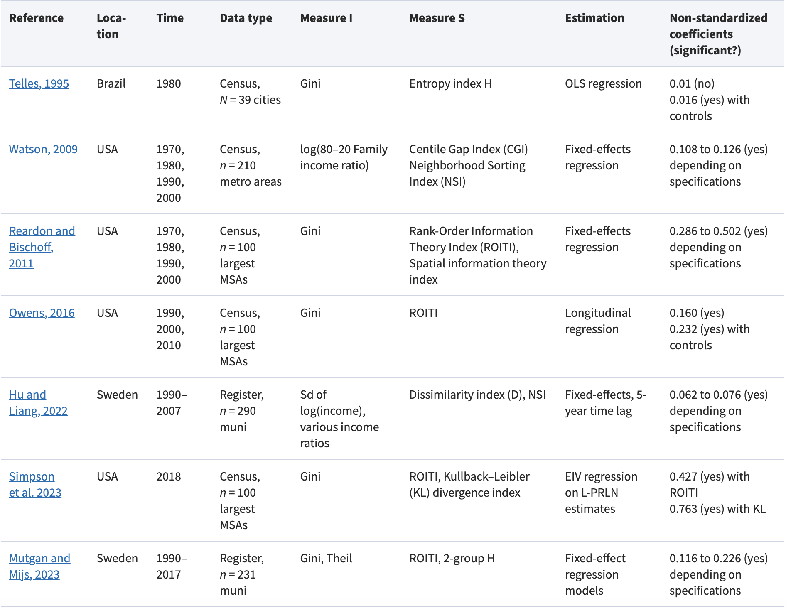

## Diversity of approaches to modelling segregation

- Modelling **causes** of segregation (pathways, timing, factors and actors [@krysan2017cycle])
- Modelling **patterns** of segregation (spatial concentration, social frontiers [@dean2019frontiers], multiscale patterns [@manley2019multiscale])
- Modelling **consequences** of segregation (neighbourhood effects [@galster2017spatial] [@tammaru2021spatial], reduction of network diversity and cohesion)

## Diversity of epistemologies within SEGUE

- **Theoretical** modelling: causal pathways and multidisciplinary approaches
- **Empirical** modelling: factors associated with income/wealth segregation variation
- **Agent-based** modelling: mechanism-based explanation of segregation persistence

# Theoretical modelling {background-gradient="linear-gradient(135deg, white 30%, #00A99D)"}

## Literature review

- Does economic segregation vary with economic inequality? 
- To what extent are the two phenomena linked?
- Which causal pathways and mechanisms are proposed to explain their connection?
- To what extent does existing research belong to distinct literatures?
- What are the consequences regarding the comparability of results and the compatibility of mechanisms?

## A large field {.smaller}

{width="100%"}

## Multiplex phenomenon {.scrollable}

{width="100%"}

[@cottineau2025economic]

## 

{width="120%"}

## 

{width="100%"}

## Conclusions

- Does economic segregation vary with economic inequality? ✅
- To what extent are the two phenomena linked? 🤷
- Which causal pathways and mechanisms are proposed to explain their connection? 🏡🎓💼
- To what extent does existing research belong to distinct literatures? 🤝
- What are the consequences regarding the comparability of results and the compatibility of mechanisms? ☠️

# Empirical modelling {background-gradient="linear-gradient(135deg, white 30%, #93278F)"}

## Regression of income and wealth segregation with:

- economic inequality [@san_millan_economic_2025] [@sanmillan2025wealth]
- city size [@san_millan_economic_2025]
- social housing concentration  [@san2026inequality] 
- social housing allocation rules [@buitrago2026]

## Effect of public policy

> Housing vouchers are not necessarily used to reduce economic segregation. Household operate trade-offs between units quality, place attachment and bundle of opportunity

[@deluca2020not]

- housing unit selection
- residential neighbourhood

# Agent-based modelling {background-gradient="linear-gradient(135deg, white 30%, #f57b26)"}

## Mechanisms behind segregation emergence and persistence [@paulinaslr]

- Homophily & clustering (Schelling)
- Real estate markets in unequal societies 
- Urban morphology & segregative potential

## Additional considerations in SEGUE

- **Lifecourse of residential needs**: residential needs (housing unit + residential environments) vary with household transitions. 
- **Contextual effects**: individuals’ bundle of opportunities depend on where they spend time and who they are exposed to. 
- **Wealth accumulation through residential real estate**: houses as shelters and assets in capitalist societies.
- **Social housing** and the geography of supply price distortion

## Thank you {.scrollable .smaller}

::: {#refs}
:::
